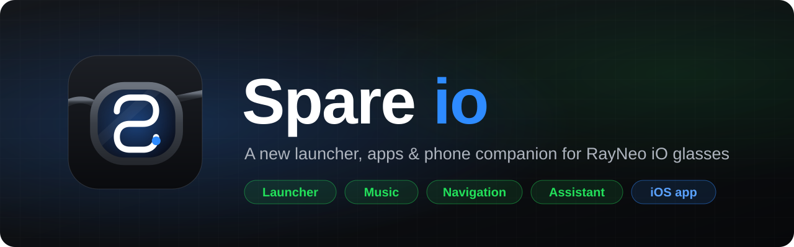
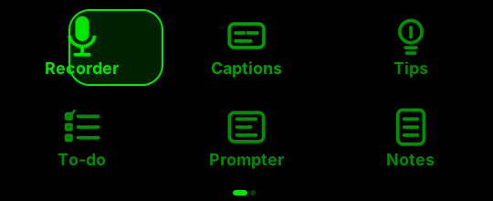
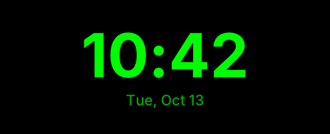
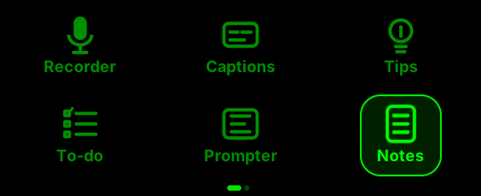
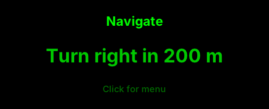

<p align="center">
  
</p>

<p align="center">
  <b>A new launcher UI for RayNeo iO smart glasses.</b><br>
  This repository is the open UI layer: pages, animations and the app SDK header. Source-available, non-commercial.
</p>

<p align="center">
  <a href="LICENSE"></a>
  
  
</p>

<p align="center">
  <a href="README.zh-CN.md">简体中文</a> ·
  <a href="#get-the-full-version">Get the full version</a> ·
  <a href="#whats-in-this-repository">What's here</a> ·
  <a href="#quick-start">Quick start</a> ·
  <a href="#support-spare-io">Support</a>
</p>

<p align="center">
  
  <br><sub>The 3 × 2 app grid with its spring "bubble" focus, rendered on a computer from the C code in this repository.</sub>
</p>

> [!WARNING]
> **Unofficial project.** Spare io is not affiliated with, endorsed by or sponsored by RayNeo. This repository contains no RayNeo firmware, app code, images or fonts.

## Get the full version

The complete Spare io (glasses system, one-tap updates, live captions and translation, navigation, music, AI assistant) ships in the **Spare io** iPhone app. No building required. Downloads and news: **[spare.cool/en/io](https://spare.cool/en/io)**.

Only trust links published there. Any other app called "Spare io", or a paid copy, is not ours.

## What's in this repository

| What | Where |
|---|---|
| Launcher pages: time page, control center, 3 × 2 app page, in-app card | `firmware/apps/frontend-v1/` |
| Page state machine, app registry, spring animation | `fe_state.c`, `fe_registry.c`, `fe_spring.h` |
| Original icons and glyphs (SVG sources) | `firmware/apps/frontend-v1/assets/` |
| Host LVGL preview renderer | `firmware/apps/frontend-v1/backend-lvgl/host/` |
| Glasses app SDK header | `firmware/sdk/sg_sdk.h` |

The glasses runtime, phone link, firmware tooling and feature apps are not part of this repository.

<table>
  <tr>
    <td width="50%" valign="top">
      <br>
      <b>Control center</b><br>
      Brightness and volume sliders, Do Not Disturb, Bluetooth and battery tiles, all driven by the crown.
    </td>
    <td width="50%" valign="top">
      <br>
      <b>Launcher</b><br>
      3 columns × 2 rows, six icons per page, spring bubble focus, neighbour fades, no-overshoot paging.
    </td>
  </tr>
  <tr>
    <td width="50%" valign="top">
      <br>
      <b>One in-app card</b><br>
      Click inside any app for a three-button card: Back, Control center, Exit.
    </td>
    <td width="50%" valign="top">
      <b>One set of controls</b><br>
      Rotate to move focus, click to confirm, long-press for the AI assistant. No double-clicks, no hidden gestures. Details in <a href="docs/frontend-v1.md">docs/frontend-v1.md</a> (Chinese).
    </td>
  </tr>
</table>

## Quick start

Needs macOS with the Xcode command line tools.

```sh
git clone https://github.com/owenc1122/spare-io.git && cd spare-io

# Unit tests for the state machine and pages (ASan + UBSan)
make -C firmware/apps/frontend-v1 test

# Render every page and transition into build/frontend-preview/
# Needs Noto Sans SC: put NotoSansSC-Regular.ttf and NotoSansSC-Bold.ttf in fonts/, or set NOTO_SC_DIR
make -C firmware/apps/frontend-v1 preview
```

## Contributing

UI improvements, animation tweaks and bug reports are welcome. Read [CONTRIBUTING.md](CONTRIBUTING.md) first, and report security issues privately as described in [SECURITY.md](SECURITY.md).

## Support Spare io

Spare io is built by a small team, one late night at a time. If it made your glasses a little nicer, you can buy us a coffee ☕ at **[paypal.me/SpareTecnology](https://paypal.me/SpareTecnology)** (Technologie Spare inc.). A ⭐ star or telling a friend who wears RayNeo glasses helps just as much.

<sub>Tips are voluntary support, not a purchase, and come with no commercial licence or service commitment.</sub>

## License

This repository is licensed under the [PolyForm Noncommercial License 1.0.0](LICENSE).

- **Allowed:** personal use, study, research, and non-commercial forks and contributions.
- **Not allowed without written permission:** selling it, bundling it into paid hardware or services, or monetising it with ads or subscriptions. This also covers rewrites, ports and AI-generated derivatives of this code.
- **Brand:** the Spare and Spare io names, logos and icons are trademarks of Technologie Spare inc. See [TRADEMARKS.md](TRADEMARKS.md).
- **Commercial licensing:** support@spare.cool.

RayNeo is a trademark of its respective owner and is used here only to describe compatibility. Third-party notices are in [NOTICE](NOTICE).
