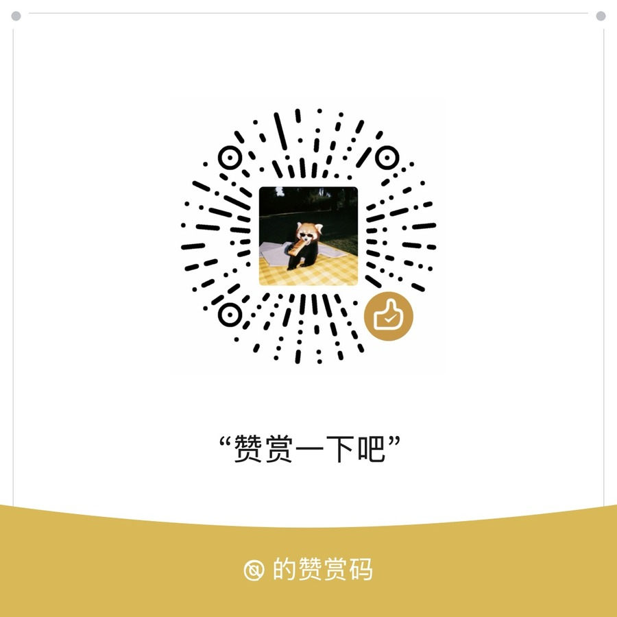

<p align="center">
  
</p>

<p align="center">
  <b>雷鸟 iO 智能眼镜的全新启动器界面。</b><br>
  本仓库公开的是界面层：页面、动效和 App SDK 接口。源码公开，禁止商用。
</p>

<p align="center">
  <a href="LICENSE"></a>
  
  
</p>

<p align="center">
  <a href="README.md">English</a> ·
  <a href="#下载完整版">下载完整版</a> ·
  <a href="#仓库里有什么">仓库里有什么</a> ·
  <a href="#快速开始">快速开始</a> ·
  <a href="#支持-spare-io">支持我们</a>
</p>

<p align="center">
  
  <br><sub>3 × 2 App 网格与弹簧「泡泡」焦点，由本仓库的 C 源码在电脑上渲染。</sub>
</p>

> [!WARNING]
> **非官方项目。** Spare io 与雷鸟（RayNeo）没有任何隶属、授权或合作关系。本仓库不含任何雷鸟固件、App 代码、图片或字体。

## 下载完整版

完整的 Spare io（眼镜系统、一键升级、实时字幕与翻译、导航、音乐、AI 助手）通过 iPhone App **Spare io** 提供，不需要自己编译。下载和最新消息见 **[spare.cool/io](https://spare.cool/io)**。

只认官网公布的链接。其他叫 "Spare io" 的 App 或收费版本都不是我们的。

## 仓库里有什么

| 内容 | 位置 |
|---|---|
| 启动器页面：时间页、控制中心、3 × 2 App 页、App 内卡片 | `firmware/apps/frontend-v1/` |
| 页面状态机、App 注册表、弹簧动效 | `fe_state.c`、`fe_registry.c`、`fe_spring.h` |
| 原创图标与字形（SVG 源文件） | `firmware/apps/frontend-v1/assets/` |
| 电脑端 LVGL 预览渲染器 | `firmware/apps/frontend-v1/backend-lvgl/host/` |
| 眼镜 App SDK 接口头文件 | `firmware/sdk/sg_sdk.h` |

眼镜端运行时、手机连接、固件工具和各个功能 App 不在本仓库中。

<table>
  <tr>
    <td width="50%" valign="top">
      <br>
      <b>控制中心</b><br>
      亮度、音量滑块，勿扰、蓝牙、电量瓷砖，全部用表冠操作。
    </td>
    <td width="50%" valign="top">
      <br>
      <b>启动器</b><br>
      3 列 × 2 行，每屏 6 个图标；弹簧泡泡焦点、邻格渐变、无过冲翻页。
    </td>
  </tr>
  <tr>
    <td width="50%" valign="top">
      <br>
      <b>统一的 App 内卡片</b><br>
      在任意 App 内单击，弹出三键卡片：返回、控制中心、退出。
    </td>
    <td width="50%" valign="top">
      <b>一套操作</b><br>
      旋转移动焦点，单击确认，长按呼出 AI 助手。没有双击，没有隐藏手势。交互细节见 <a href="docs/frontend-v1.md">docs/frontend-v1.md</a>。
    </td>
  </tr>
</table>

## 快速开始

需要 macOS 和 Xcode 命令行工具。

```sh
git clone https://github.com/owenc1122/spare-io.git && cd spare-io

# 状态机与页面的单元测试（ASan + UBSan）
make -C firmware/apps/frontend-v1 test

# 渲染所有页面和转场到 build/frontend-preview/
# 需要 Noto Sans SC 字体：把 NotoSansSC-Regular.ttf 和 NotoSansSC-Bold.ttf 放进 fonts/，或设置 NOTO_SC_DIR
make -C firmware/apps/frontend-v1 preview
```

## 接入自己的 Agent

用你自己的 Agent（Codex CLI、Claude Code、OpenClaw、Ollama 或任何 OpenAI 兼容端点）做眼镜助手：[`agent-bridge/`](agent-bridge/) 是一个小型参考桥，协议见 [docs/agent/PROTOCOL.zh-CN.md](docs/agent/PROTOCOL.zh-CN.md)（Spare Agent 协议 v1）。

## 参与贡献

欢迎提交界面改进、动效调整和 bug。请先读 [CONTRIBUTING.md](CONTRIBUTING.md)。安全问题请按 [SECURITY.md](SECURITY.md) 私下报告。

## 支持 Spare io

Spare io 是一个小团队在一个个夜晚里慢慢做出来的。如果它让你的眼镜更好用了一点，欢迎请我们喝杯咖啡 ☕。暂时不方便也没关系：点一个 ⭐ Star，或者把 Spare io 分享给戴雷鸟眼镜的朋友，对我们同样珍贵。

<table>
  <tr>
    <td align="center"><br><sub>微信赞赏</sub></td>
    <td align="center"><br><sub>微信支付</sub></td>
  </tr>
</table>

**海外朋友：** 可以通过 PayPal 支持：**[paypal.me/SpareTecnology](https://paypal.me/SpareTecnology)**（Technologie Spare inc.）。

<sub>打赏属于自愿支持，不是购买，不附带任何商业授权或服务承诺。</sub>

## 许可

本仓库采用 [PolyForm Noncommercial License 1.0.0](LICENSE)（PolyForm 非商业许可）。

- **允许：** 个人使用、学习、研究，以及非商业的分支和贡献。
- **未经书面授权禁止：** 出售、捆绑到收费硬件或服务中、用广告或订阅变现。基于本代码改写、移植或借助 AI 工具生成的版本同样适用。
- **品牌：** Spare、Spare io 的名称、标志和图标是 Technologie Spare inc. 的商标，见 [TRADEMARKS.zh-CN.md](TRADEMARKS.zh-CN.md)。
- **商业授权：** support@spare.cool。

RayNeo / 雷鸟是其各自所有者的商标，此处仅用于说明兼容性。第三方声明见 [NOTICE](NOTICE)。
